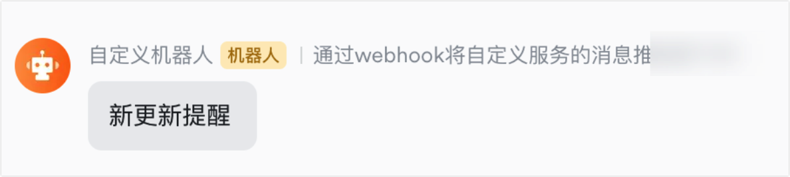
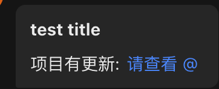
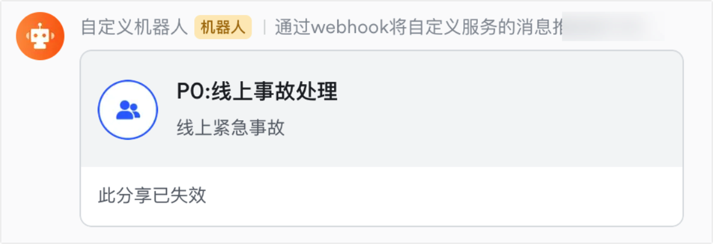
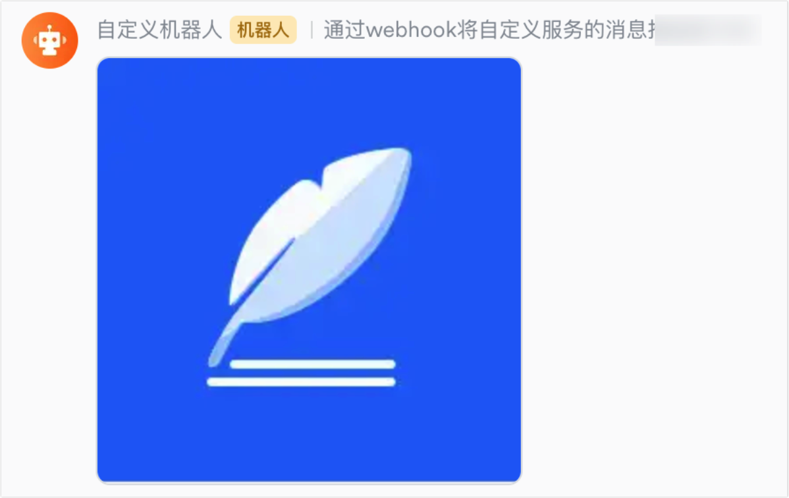
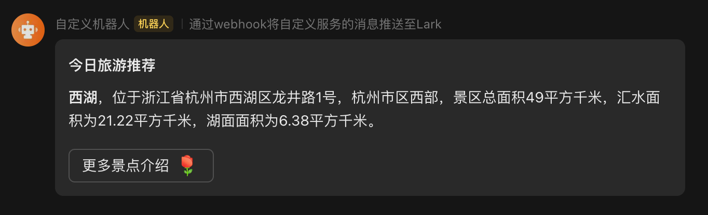

# component：独立业务组件

> 返回 [README](../../README.md)。

| 组件 | 包 |
|-|-|
| [jwt](#jwt) | `library/component/jwt` |
| [lark-message](#lark-message) | `library/component/lark-message` |
| [ali-sms](#ali-sms) | `library/component/ali-sms` |
| [限流](#限流) | `util/ratelimit`、`library/component/limiter`、`library/component/throttle` |
| [对象存储](#对象存储) | `library/component/storage`、`library/component/object-storage` |
| [凭据引用](secret.md) | `library/component/secret`（单独成篇） |

## jwt

基于 [golang-jwt](https://github.com/golang-jwt/jwt) 的 JWT 生成与解析：生成使用 HS256，解析接受任意 HMAC 算法（HS256/384/512）。包内已提供用户态载荷 `AuthClaims` 与构造函数 `NewAuthClaims`。

```go
import cjwt "github.com/coderyw/gomicro-util/library/component/jwt"

secret := []byte("<jwt_secret>")

// 生成 token
claims := cjwt.NewAuthClaims(1001, "com.example.app", 14*time.Hour)
token, err := cjwt.GenerateToken(claims, secret)

// 解析 token；skipValidate=true 时跳过过期等校验
parsed, err := cjwt.ParseToken(token, secret, &cjwt.AuthClaims{}, false)
```

## lark-message

lark-message 是一个基于 webhook 的 lark 自定义机器人消息推送组件。[了解详情](https://open.larksuite.com/document/client-docs/bot-v3/add-custom-bot?lang=zh-CN).

- 开启方式：需要程序启动时候在 yaml 或者 json 配置文件中配置

```yaml
lark_cfg:
  groups:            # 必须有这一层
    group_1:
      webhook: https://open.feishu.cn/open-apis/bot/v2/hook/<token>
      sign: <sign_secret>
      enabled: true  # 可选，false 时静默不发送
```

也可以不写配置文件，直接给全局变量 `config.LarkConfig`（`model/config/lark.go`）赋值。`SendLarkMessage` 的第二个参数是配置中的群组 key（如 `group_1`）。

- 支持消息类型
  - **文本消息**
  
  ```go
  lark_message.SendLarkMessage(context.Background(), "group_1",  &lark_message.LarkMessageTextReqBuilder{
      Text: "test message",
  })
  ```

  

  - **富文本消息**

  ```go
  lark_message.SendLarkMessage(context.Background(), "group_1",  &lark_message.LarkMessagePostReqBuilder{
      Post: Post{
        ZhCn: PostZhCn{
          Title: "test title",
          Content: [][]PostContent{
            {
              {
                Tag:  "text",
                Text: "项目有更新: ",
              },
              {
                Tag:  "a",
                Text: "请查看",
                PostA: PostA{
                  Href: "https://www.baidu.com",
                },
              },
              {
                Tag: "at",
                PostAt: PostAt{
                  UserID: "ou_7d8a6e6df7621556ce0d21922b676706ccs",
                },
              },
            },
          },
        },
      }
    }
  })
  ```

  

  - **群名片**

  ```go
  lark_message.SendLarkMessage(context.Background(), "group_1",  &lark_message.LarkMessageShareChatReqBuilder{
      ShareChatId: "oc_f5b1a7eb27ae2****339ff",
  })
  ```

  

  - **发送图片**

  ```go
  lark_message.SendLarkMessage(context.Background(), "group_1",  &lark_message.LarkMessageImageReqBuilder{
      ImageKey: "oc_f5b1a7eb27ae2****339ff",
  })
  ```

  

  - **发送卡片消息**

  ```go
  lark_message.SendLarkMessage(context.Background(), "group_1",  &lark_message.LarkMessageCardReqBuilder{
      Header: CardHeader{
          Title: CardTitle{
            Content: "今日旅游推荐",
            Tag:     "plain_text",
          },
        },
        Elements: []CardElements{
          {
            Tag: "div",
            Text: CardText{
              Content: "**西湖**，位于浙江省杭州市西湖区龙井路1号，杭州市区西部，景区总面积49平方千米，汇水面积为21.22平方千米，湖面面积为6.38平方千米。",
              Tag:     "lark_md",
            },
          },
          {
            Actions: []CardActions{
              {
                Tag: "button",
                Text: CardText{
                  Content: "更多景点介绍 :玫瑰:",
                  Tag:     "lark_md",
                },
                URL:  "https://www.example.com",
                Type: "default",
                Value: map[string]interface{}{
                  "key": "value",
                },
              },
            },
            Tag: "action",
          },
        },
  })
  ```

  

## ali-sms

阿里云短信验证码发送。配置**只从 etcd 读取**，key 为 `/{env}/config/ali_sms_ver`，值为 JSON：

```go
type AliSmsCfg struct {
	AccessKey    string `json:"access_key"`
	AccessSecret string `json:"access_secret"`
	SignName     string `json:"sign_name"`     // ⚠️ 当前未使用，代码写死为 linkysw
	TemplateCode string `json:"template_code"` // ⚠️ 当前未使用，代码写死为 SMS_268605666
}
```

```go
err := ali_sms.SendAliVerCodeSms("<手机号>", "123456")
```

> ⚠️ 发送失败（阿里云返回非 OK 或 SDK 报错）时，当前实现**不会返回错误**，只有读取配置、创建客户端失败才会返回 err。

## 限流

本库提供三套定位不同的限流实现，按使用场景选择：

| 包 | 模型 | 核心 API | 适用场景 |
|---|---|---|---|
| `util/ratelimit` | **阻塞等待式**分布式令牌桶（自研 Lua，多实例共享 key；支持 n > 容量的分段消耗；Redis 故障时降级放行） | `NewTokenBucketLimiter(key, ratePerSec)` → `WaitN(ctx, n)` | 出口流量整形：调第三方接口 / 批量任务，需要「等到有配额再执行」 |
| `library/component/limiter` | **非阻塞判断式**令牌桶（EvalSha 缓存脚本，支持普通 key 与 IP 两套速率） | `NewTokenBucketLimiter(redisClient)` → `Consume(ctx, key) (bool, error)` | 请求准入：一次调用立即得到「放行 / 拒绝」 |
| `library/component/throttle` | **配置驱动的可运营限流器**：配置存 Redis hash，每 10s 定时热加载；支持固定窗口 / 令牌桶两种引擎 × 用户维度 / 用户+接口维度，带黑名单开关 | `InitWindowLimiter(ctx, rdb)` 或 `InitBucketLimiter(ctx, rdb)`（二选一）→ `GetGlobalTokenLimiter().Limit(ctx, userId)` | 网关/中间件层按用户、按接口限流，运营改 Redis 配置实时生效 |

- **阻塞等待式（util/ratelimit）示例**

  ```go
  // 全实例合计每秒最多 150 个令牌；n 可大于容量，内部自动分段
  limiter := ratelimit.NewTokenBucketLimiter("rl:third-api", 150)
  if err := limiter.WaitN(ctx, 1); err != nil {
      return err // ctx 取消/超时才返回 error；Redis 故障会降级放行
  }
  // 拿到配额，执行受限操作
  ```

- **非阻塞判断式（component/limiter）示例**

  ```go
  l := limiter.NewTokenBucketLimiter(redisClient)
  ok, err := l.Consume(ctx, "user:123")
  if err != nil { /* Redis 异常处理 */ }
  if !ok {
      return errTooManyRequests // 令牌不足，拒绝
  }
  ```

## 对象存储

推荐使用 `library/component/storage`：统一的上传注册入口，按实例名路由到 `internal/storage` 中的 provider，当前支持 **AWS S3**（`aws_s3_config`）与**华为云 OBS**（`huawei_obs_config`），并支持多租户路径隔离。配置见 [configuration.md](../configuration.md) 的 `storage.object_storage` 段，用法见 [storage/README.md](../../library/component/storage/README.md)。

> ⚠️ ctx 中没有租户时，`component/storage` 会使用默认租户 `ns`，key 变成 `tenantns/{key}`（设置了 `TENANT_FALLBACK` 的 pod 除外）。后台任务、异步 goroutine 中请务必传入带租户的 ctx。

旧接口 `library/component/object-storage` 目前只有 S3 provider（`provider/s3`），且没有导出构造函数，外部无法直接使用；它透传调用方的资源名，**不做自动租户隔离**。新代码请使用 `component/storage`。

> ⚠️ 使用重试上传时请传入可重放的数据源（`io.ReadSeeker`），一次性 `io.Reader` 在重试时会上传空/截断内容。
