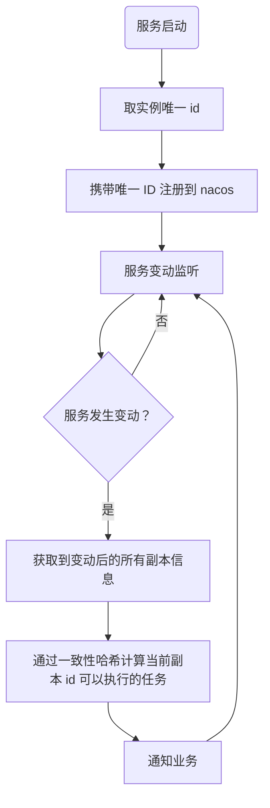

# 定时任务与任务分片

> 返回 [README](../../README.md)。

## cron

定时任务组件，底层基于 [robfig/cron](https://github.com/robfig/cron)。任务模型为 `model/cron.CronJob`：

```go
type CronJob struct {
	Name  string // 任务唯一标识
	DoJob func() // 执行函数
	// cron 表达式，6 段：秒 分 时 日 月 周，例如 "0 1 5 * * ?" 表示每天 05:01:00
	CronSpc string
	// 任务未完成时是否可以执行下次任务
	DoBeforeDone bool
	// DoBeforeDone=false 时生效：true=等当前任务完成后补执行，false=跳过下次
	DelayBeforeDone bool
}
```

### cron 表达式

使用 robfig/cron 的 `WithSeconds()` 解析器，固定 6 段：`秒 分 时 日 月 周`。

| 段 | 取值 |
|-|-|
| 秒、分 | 0-59 |
| 时 | 0-23 |
| 日 | 1-31 |
| 月 | 1-12 或 JAN-DEC |
| 周 | 0-6 或 SUN-SAT（0 为周日） |

支持 `*`（任意）、`?`（日/周中等同 `*`）、`-`（范围）、`,`（列表）、`/`（步长），以及 `@every 1m30s`、`@daily` 等描述符。**不支持** Quartz 的 `L`、`W`、`#` 与年份段。

| 表达式 | 含义 |
|-|-|
| `0/1 * * * * ?` | 每秒 |
| `15 * * * * ?` | 每分钟第 15 秒 |
| `0 0 14 * * ?` | 每天 14:00 |
| `0 0 8 ? * MON-FRI` | 工作日 08:00 |
| `0 1 5 * * ?` | 每天 05:01 |

### 通过 pmicro 注册（推荐）

```go
prog := pmicro.NewProgram(
	option.ServiceName("service-name"),
	option.Cron(cron.CronJob{
		Name:    "daily-report",
		DoJob:   func() { log.Info("run") },
		CronSpc: "0 1 5 * * ?",
	}),
)
```

### 不使用 pmicro

```go
// 包初始化时已创建并启动全局 cron 实例，直接 AddCron 即可；
// Init 受 sync.Once 保护，重复调用无效果；CloseCron 之后无法再重新启动
cron.AddCron(cron.CronJob{ /* ... */ })
```

### 多租户定时任务（TenantCron）

多租户部署下，定时任务通常需要「对每个租户各执行一次，且同一租户在集群内只执行一次」。`cron.NewTenantCron` 把 `func(ctx)` 包装成 `DoJob`：

```go
tc := cron.NewTenantCron("bmp-activity",
	cron.WithLockFunc(myRedisLock),     // 必传，否则默认无锁执行
	cron.WithMaxConcurrency(10),        // 租户并发数，默认 10
	cron.WithTimeout(time.Hour),        // 单租户超时，默认 6h
)
option.Cron(cron.CronJob{
	Name:    "warmup",
	CronSpc: "0 */5 * * * ?",
	DoJob:   tc.Wrap("warmup_ticket", func(ctx context.Context) { /* ctx 已带租户 */ }),
})
```

- 默认通过 `namespace.GetTenantsInNamespace` 获取租户列表；锁 key 自动拼接租户
- 配置了 `TENANT_FALLBACK` 时只用无租户 ctx 执行一次
- 单个租户失败不影响其他租户

## consistent_hash

这是一个一致性哈希组件，用于实现一致性哈希。组件基于nacos 的注册。当服务使用 nacos 作为注册中心时候，会向 nacos 注册一个监听协程，当服务副本数量发生变动时候，会通过监听协程通知组件，
组件会自动更新一致性哈希结果。

- 优点：
  - 降低了分配任务的复杂度，每个副本只需要关心经过一致性哈希计算后的所执行的任务
  - 避免了任务分配的负载均衡问题
  - 避免了任务分配的节点压力

- 缺点：
  - 当某个副本频繁重启时，会造成一致性哈希频繁计算（可以通过算法优化）
  - nacos 监听如果发生失败，可能会造成节点任务分配重复问题。（需要业务逻辑实现锁）

- 使用方式：

```go
// key：业务唯一标识；values：待分配的全部任务，例如 []string{"1", "2", "3"}
ok, noticeChan, err := consistent_hash.OnChange("my-jobs", []string{"1", "2", "3"})
// ok=false 表示该 key 已注册过，此时 noticeChan 为 nil

for notice := range noticeChan {
	notice.BusinessKey // 业务标识
	notice.Jobs        // 当前副本应执行的任务，例如 []string{"1"}；可能为空
}
```

注意：`OnChange` 不区分租户，多租户场景需在 key 中自行带上租户。

通知时机：注册时立即下发一次；之后每 10s 重新拉取实例列表，有变化时下发；约每 60s 即使没有变化也强制重新下发一次。通道缓冲为 1，消费不及时的通知会被丢弃，因此请以**最近一次通知**为准。nacos 实例的 metadata 中没有 `id`、不健康或未启用时不参与分配。

- 原理：
  - 每个副本使用环境变量 `ID` 作为唯一 id，未配置时启动时生成 UUID（见 `env.GetId()`）
  - 在使用 nacos 进行服务注册时候，会将唯一 id 注册为元数据给 nacos
  - 在使用 nacos 进行服务变动监听时候，nacos 会将变动后的所有副本信息都发送过来（包含元数据唯一 id）
  - 通过一致性哈希进行计算当前副本 id 可以执行的任务数组
  - 通知业务可执行任务发生变动
  


更多说明见 [consistent_hash/README.md](../../library/consistent_hash/README.md)。
