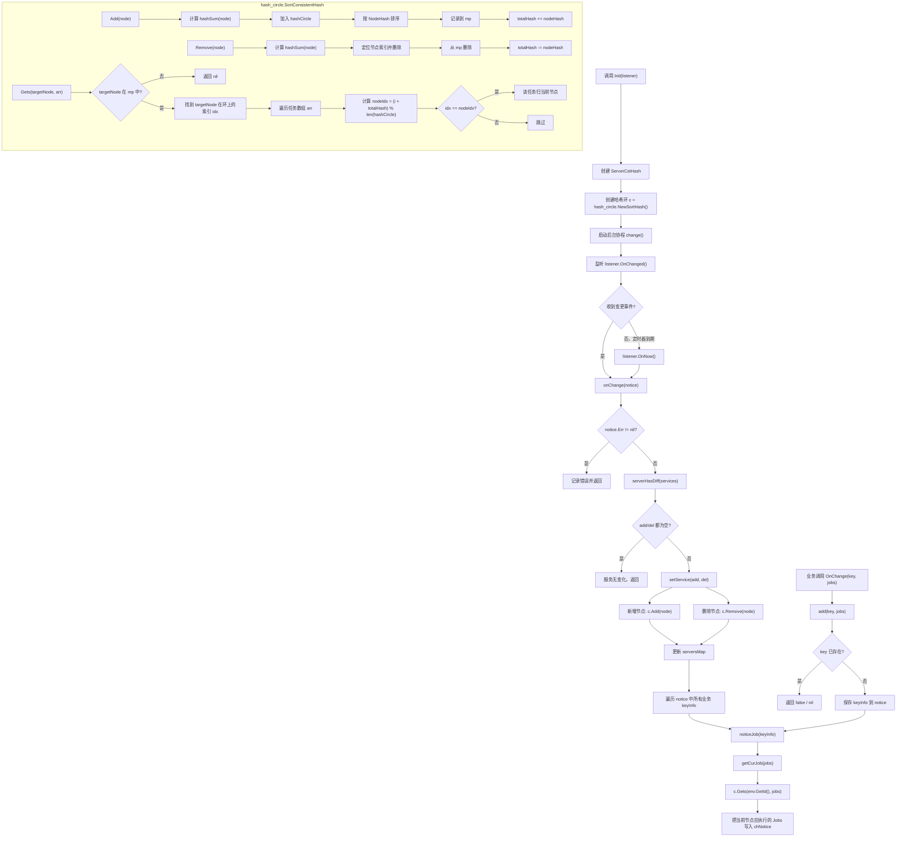

# consistent_hash

`library/consistent_hash` 提供了一个面向服务节点变更的一致性任务分配实现。

当前包的核心流程：

- `Init(listener)` 初始化 `ServerCstHash`，创建 `hash_circle.NewSortHash()` 并启动后台监听协程。
- 监听器收到服务节点变化后，计算新增/删除节点并更新哈希环。
- 业务侧通过 `OnChange(key, jobs)` 注册关注的任务集合。
- 节点变化后，系统重新计算当前实例 `env.GetId()` 应负责的 `jobs`，并通过 `chNotice` 通知业务方。

## Flowchart

