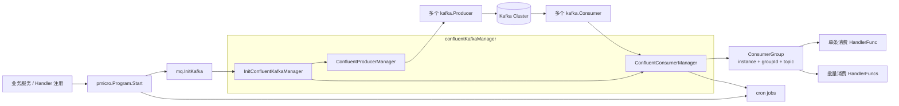
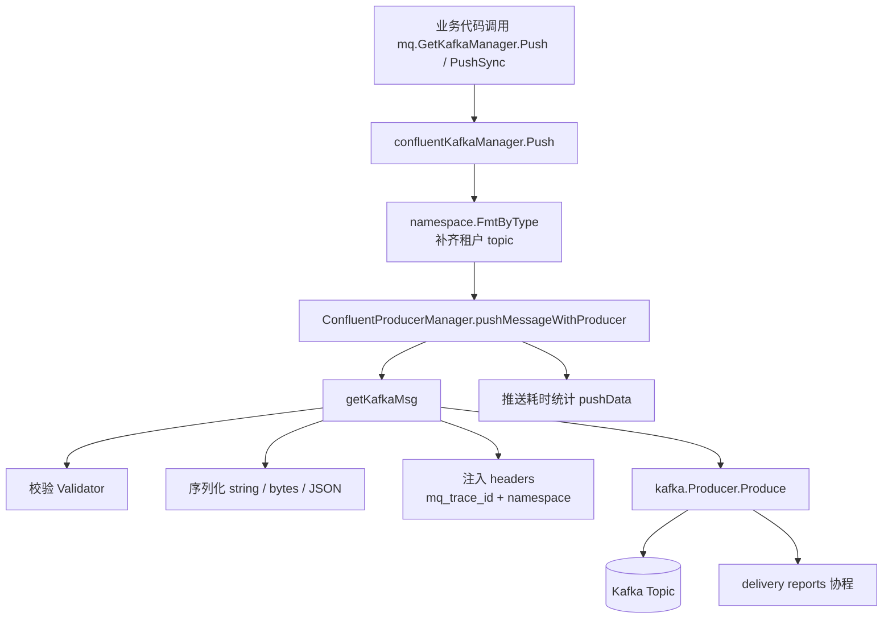
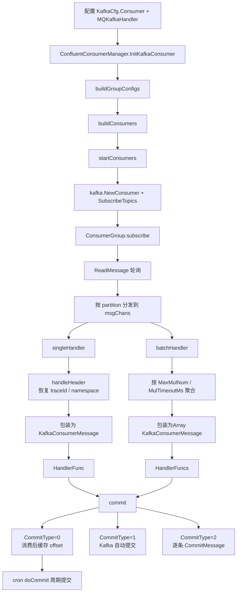
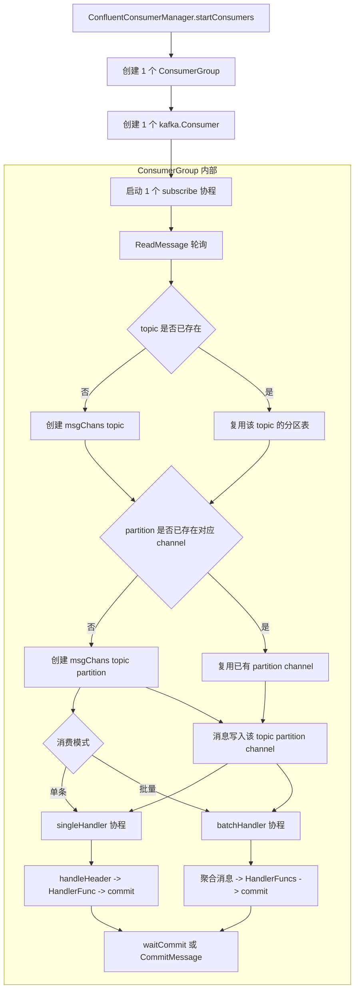
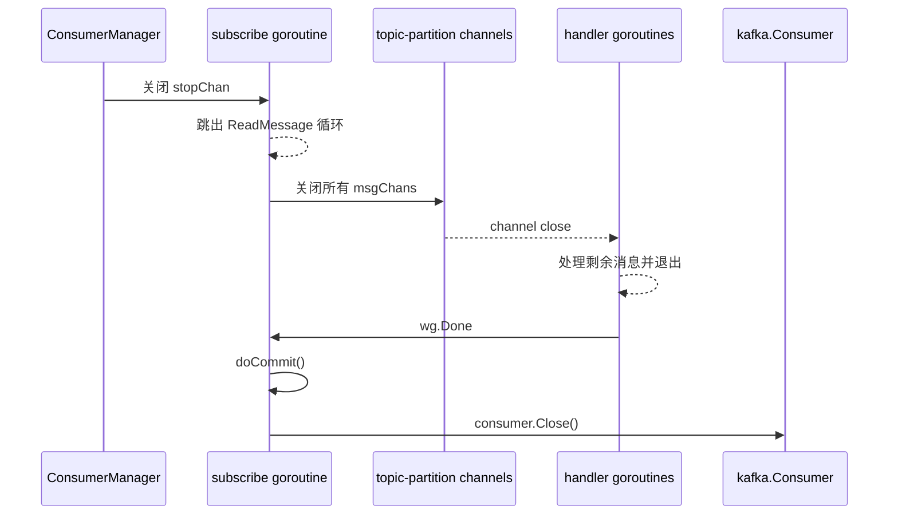

# Kafka Architecture

本文档描述 `library/mq/kafka` 在当前仓库中的运行结构，基于 `confluent-kafka-go` 实现。

## Overall

## Producer Flow

## Consumer Flow

## Consumer Concurrency Model

这里的“线程模型”更准确地说是 Go 协程模型。当前实现里，一个 `ConsumerGroup` 绑定一个 `kafka.Consumer` 和一个 `subscribe()` 读协程；但由于订阅使用正则，单个 `ConsumerGroup` 可能同时消费多个实际 topic，所以内部已经变成 `topic -> partition -> worker` 的两级展开模型。

单个 `ConsumerGroup` 的并发规则：

- 固定 1 个读协程：`subscribe()` 负责轮询 `ReadMessage`，它自己不执行业务处理。
- 先按 topic 分层：`msgChans` 现在是 `map[topic]map[partition]chan`，用于承接正则订阅命中的多个实际 topic。
- 再按分区惰性扩容：某个 `topic/partition` 首次收到消息时，才创建该分区专属的 `channel + handler goroutine`。
- 同一 `topic/partition` 内严格串行：消息进入同一个 channel，由同一个 worker 顺序处理。
- 不同 `topic`、不同 `partition` 之间并行：只要 channel 不同，就有独立 worker。
- 并发上限约等于“当前活跃的 topic-partition 数”，而不是消息数，也不是 handler 数。
- channel 满时不会丢消息：当前实现会先打 `channel is full` 告警，然后阻塞写入，背压会直接传回读协程。

停机收敛模型：

停机阶段的顺序是：

- 先停读，不再从 Kafka 拉新消息。
- 再关闭所有 `topic/partition channel`，让已有 handler 把 channel 中剩余消息处理完。
- 等所有 handler 协程退出后，补做一次 `doCommit()`。
- 最后关闭底层 `kafka.Consumer`。

## Key Design Points

- 启动入口在 `library/pmicro/program.go`，Kafka 不是独立进程，而是作为服务启动流程的一部分初始化。
- 管理器拆分为 `ProducerManager` 和 `ConsumerManager`，由 `confluentKafkaManager` 统一对外暴露。
- 消费者实例的粒度是 `instanceName + groupId + topic`，每个实例内部再按 `partition` 开 goroutine 处理，保证分区内串行。
- `HandlerFunc` 用于单条消费，`HandlerFuncs` 用于批量消费；两者最终都走同一套 trace、日志和 offset 提交流程。
- topic 会经过 `namespace.FmtByType(...)` 处理，消费侧则通过 topic 和 header 反推 namespace 到上下文。
- 默认提交策略是 `CommitType=0`，即消费完成后先缓存 offset，再通过 cron 周期性提交。
